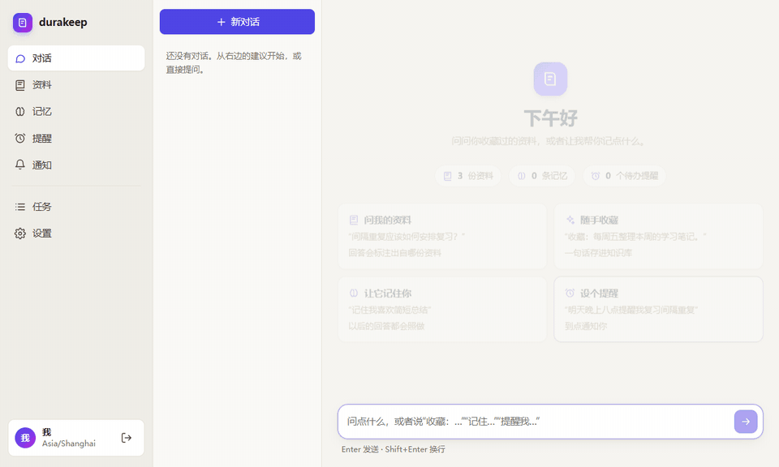
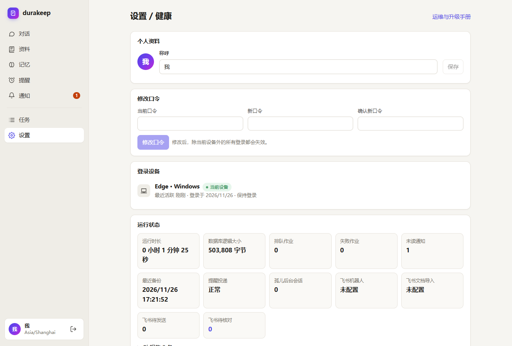
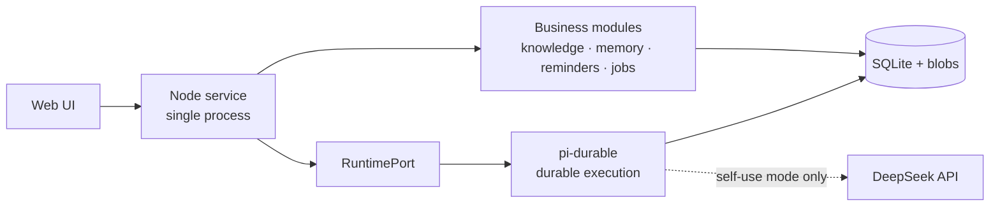

# durakeep

<p align="center">
  <b>A single-user knowledge base and daily assistant on your own machine: cited answers, and it picks up where it left off after a crash.</b>
</p>

<p align="center">
  <a href="https://github.com/BeforeLanding/durakeep/actions/workflows/ci.yml"></a>
  
  <a href="LICENSE"></a>
  · <a href="README.md">简体中文</a>
</p>

<p align="center">
  
</p>

durakeep is a single-user knowledge base and daily assistant that runs on your machine. Save material, ask questions with citations, keep long-term preferences, and set one-time reminders in natural language. [pi-durable](https://www.npmjs.com/package/@earendil-works/pi-durable) provides durable execution so unfinished chat runs can recover after a restart.

## Try the demo

Use Node.js 22.19.0 or newer (24 recommended) and pnpm 11.7.0. From the repository root, run:

```bash
pnpm install --frozen-lockfile
pnpm demo
```

Open [http://127.0.0.1:4777](http://127.0.0.1:4777) and sign in with the demo passphrase `demodemo`. The demo pre-indexes three sample documents and uses a temporary data directory and a scripted mock model. It needs no API key and incurs no model charges. Start a chat and try these prompts in the Chinese-language interface:

- **Save a note.** 收藏：每周五整理本周的学习笔记。
- **Ask for sources.** 间隔重复应该如何安排复习？
- **Remember a preference.** 记住我喜欢简短总结
- **Set a reminder.** 明天晚上八点提醒我复习间隔重复

Hover over `[1]` in the answer to read the original passage.

<details>
<summary>More: settings and health page</summary>



</details>

## Architecture at a glance



Business modules never depend on the runtime directly. Chat and tool calls go through `RuntimePort` to pi-durable, which is why unfinished runs can resume after a crash. See [architecture](docs/03-architecture.md) for the full design.

## Features

P0–P3 are complete.

- **Knowledge base and chat.** Save web pages, paste text, or upload UTF‑8 Markdown or text files. Search uses SQLite FTS5 and substring matching. Citations open the original passages. Chat supports streaming, stopping, and continuing after a failure.
- **Long-term memory and reminders.** Manage confirmed memories and candidates extracted from idle chats. Schedule one-time reminders in the account time zone and receive in-app notifications.
- **Backup, restore, and operations.** Automatic daily backups retain seven copies by default. Restore offline, replay permanent deletions, export a ZIP, and inspect health metrics and job reports. See the [operations and upgrade runbook](docs/runbook.md).
- **Monthly budget and compaction.** Track usage and estimated costs by model. At the budget limit, background model jobs pause and interactive chat remains available with a warning. Long chats are compacted automatically.
- **Demo and verification.** Try the core workflow with a zero-cost mock model. A Playwright browser smoke test covers the workflow.

## Run with your own data

After installing dependencies, build the web UI, set `DEEPSEEK_API_KEY` in the service account's environment, and start the service:

```bash
pnpm web:build
pnpm dev
```

On first start the terminal prints an 8-character setup code. Open the [local UI](http://127.0.0.1:4777), enter the code, a display name, and a passphrase to finish setup and sign in. Afterwards sign in with that passphrase, optionally staying signed in. The passphrase, display name, and signed-in devices are managed on the Settings page. You can still create the account with `pnpm cli init --timezone=Asia/Shanghai` while the service is stopped. The default model is `deepseek-flash`, adjustable in Settings. The service listens on `127.0.0.1:4777` only. The default data directory is `data/`; if you set `DATA_DIR`, use the same directory for the service and offline CLI. For long-running use, see the [runbook](docs/runbook.md) for Windows Task Scheduler or Linux systemd.

## Data transfer, durability, and deletion

**Importing Feishu docs.** Feishu documents require sign-in, so pasting a link cannot fetch them directly. Create a custom app on the Feishu Open Platform with `docx:document:readonly` and `wiki:wiki:readonly`, publish it, and set `FEISHU_APP_ID` and `FEISHU_APP_SECRET` in the service account's environment. Add the app to each document via "…" → "Add document app"; then paste the doc or wiki link to import it. Alternatively, export the doc as Word or PDF and upload it on the Library page.

**Supported sources.** Web links (including links to PDFs), Feishu docs, pasted text, and uploads of PDF (≤20 MB, must have a text layer; scanned PDFs need OCR, which is not supported yet), Word `.docx` (≤10 MB), and Markdown / TXT / HTML (≤2 MB). Web and Feishu documents can be re-fetched from the detail page; changed content becomes a new version.

To receive reminders in a Feishu or Lark group, set `FEISHU_WEBHOOK_URL` in the service account's environment. Set `FEISHU_WEBHOOK_SECRET` if the bot requires signatures. Once enabled, reminder titles, scheduled times, and late-delivery indicators are sent to the group. If the Jobs page marks a delivery as needing review, check the group before marking it delivered, retrying, or abandoning it. [Feishu setup and review procedure](docs/runbook.md#飞书外部提醒)

- **Model requests leave your machine.** In regular use, the DeepSeek API receives chat content, passages or memories used in answers, and content needed for background summaries, memory extraction, and compaction. API charges apply. DeepSeek's Open Platform policy describes its rules for storing personal information in China and for possible use of encrypted, de-identified API inputs and outputs to improve models under the stated conditions. [DeepSeek Open Platform privacy policy (Chinese)](https://cdn.deepseek.com/policies/zh-CN/deepseek-open-platform-privacy-policy.html)
- **Work recovers after an application crash.** Accepted input and committed application writes are recoverable. The unsaved tail of a streamed answer may be lost. SQLite uses WAL with `synchronous=NORMAL`, so recent commits may roll back after a power loss or an operating system crash. [SQLite durability documentation](https://www.sqlite.org/pragma.html#pragma_synchronous)
- **Permanent deletion removes material from search immediately.** A background job clears passages, indexes, summaries, and unreferenced originals. Restoring an older database replays deletions from the separately preserved `purge-log.jsonl`. Chat history, older backups, existing exports, and copies held by the model provider require separate handling. [Deletion and forgetting](docs/07-knowledge-memory.md#6-删除与遗忘)

## CLI and tests

When the service is running, use Settings / Health to start a backup or download a ZIP export. When the service is stopped, run:

```bash
pnpm cli backup
pnpm cli restore <backup-file>
pnpm cli export <directory>
```

Keep the backup manifest, required blobs, and the latest purge log before restoring. After restoring, check service health and manually resume reminder delivery. [Backup and restore procedure](docs/runbook.md#备份与恢复)

```bash
pnpm lint
pnpm test
pnpm test:recovery
pnpm test:upgrade
pnpm web:build
pnpm test:e2e
```

Tests use mock models. The browser smoke test needs local Edge, Chrome, or Playwright Chromium (install with `pnpm exec playwright install chromium`). [Test plan](docs/08-test-plan.md)

## Design and license

[Product requirements](docs/02-prd.md) · [Architecture](docs/03-architecture.md) · [HTTP API](docs/06-api.md) · [Architecture decisions](docs/DECISIONS.md) · [Runbook](docs/runbook.md) · [MIT license](LICENSE)
