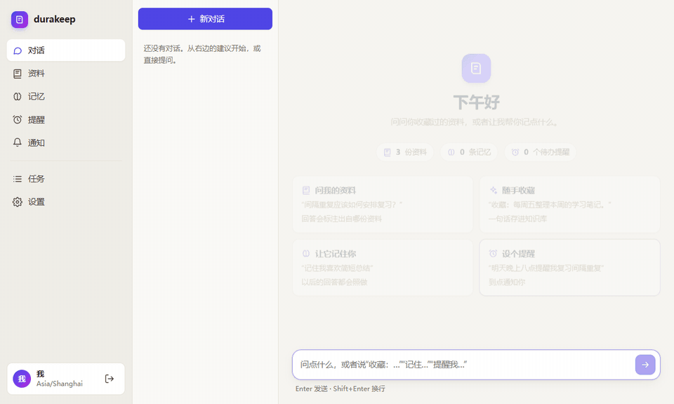
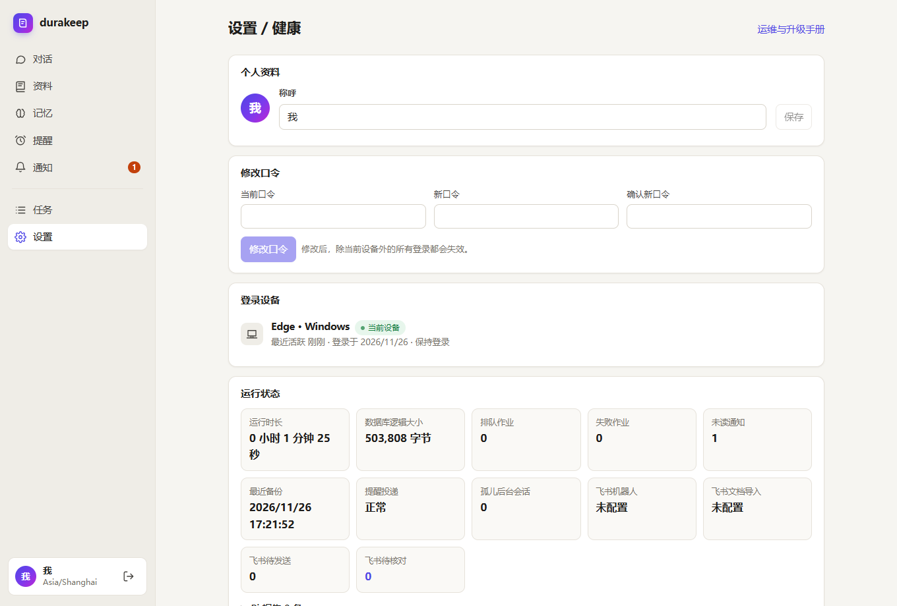
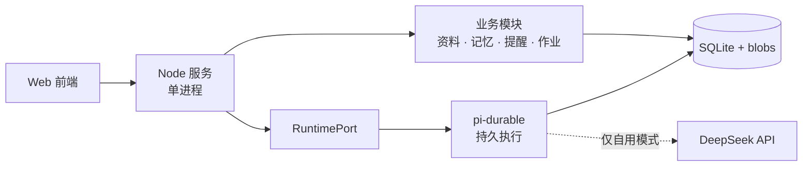

# durakeep

<p align="center">
  <b>在本机运行的单用户知识库与日常助理：带引用的回答，崩溃后能接着干。</b>
</p>

<p align="center">
  <a href="https://github.com/BeforeLanding/durakeep/actions/workflows/ci.yml"></a>
  
  <a href="LICENSE"></a>
  · <a href="README.en.md">English</a>
</p>

<p align="center">
  
</p>

durakeep 是一个在本机运行的单用户知识库和日常助理。收藏资料后，可以带着引用提问、保存长期偏好，也可以用自然语言设置一次性提醒。[pi-durable](https://www.npmjs.com/package/@earendil-works/pi-durable) 负责持久化执行，服务重启后可恢复未完成的对话任务。

## 一键体验

使用 Node.js 22.19.0 或更新版本（推荐 24）和 pnpm 11.7.0。在仓库根目录运行：

```bash
pnpm install --frozen-lockfile
pnpm demo
```

打开 [http://127.0.0.1:4777](http://127.0.0.1:4777)，使用演示口令 `demodemo` 登录。演示预先索引三篇样例，使用临时数据目录和脚本化模拟模型，无需 API key，模型费用为零。在对话页新建会话，试试这几句话：

- 收藏：每周五整理本周的学习笔记。
- 间隔重复应该如何安排复习？
- 记住我喜欢简短总结
- 明天晚上八点提醒我复习间隔重复

把鼠标移到回答中的 `[1]` 上，就能查看引用的原文。

<details>
<summary>更多截图：设置与健康页</summary>



</details>

## 架构一览



业务模块不直接依赖运行时，对话与工具调用经 `RuntimePort` 交给 pi-durable，因此进程崩溃后可恢复未完成的任务。完整设计见[系统架构](docs/03-architecture.md)。

## 已完成功能

P0–P3 已完成。

- **知识库与对话。** 收藏网页、粘贴文本或上传 UTF‑8 Markdown / 文本。使用 SQLite FTS5 和子串检索，回答引用可追溯到原文。支持流式对话、停止和失败后继续。
- **长期记忆与提醒。** 管理已确认的记忆和从空闲对话提取的候选。按账户时区设置一次性提醒，到期后收到站内通知。
- **备份、恢复与运维。** 每日自动备份，默认保留七份。支持离线恢复、重放彻底删除、ZIP 导出，以及健康指标和作业报告。部署与升级步骤见[运维手册](docs/runbook.md)。
- **月度预算与压缩。** 按模型统计用量和估算费用。达到预算时暂停后台模型作业，交互对话仍可使用并显示超支提示。长对话会自动压缩。
- **演示与验证。** 使用零费用模拟模型体验主流程，并通过 Playwright 浏览器冒烟测试验证。

## 自用部署

安装依赖后构建前端，在运行账号的环境中设置 `DEEPSEEK_API_KEY`，然后启动服务：

```bash
pnpm web:build
pnpm dev
```

首次启动时终端会打印一个 8 位设置码。打开 [本机界面](http://127.0.0.1:4777)，输入设置码、称呼和口令即可完成设置并自动登录；之后用这个口令登录，可选择“保持登录”。口令、称呼与登录设备可在设置页管理。也可以在服务停止时用 `pnpm cli init --timezone=Asia/Shanghai` 创建账户。默认模型是 `deepseek-flash`，可在设置页调整。服务默认仅监听 `127.0.0.1:4777`。默认数据目录是 `data/`。如用 `DATA_DIR` 指定其他目录，请让初始化、服务与离线 CLI 使用同一目录。长期运行可使用 Windows 任务计划程序或 Linux systemd，配置见[运维手册](docs/runbook.md)。

## 数据传输、持久性与删除

**导入飞书文档。** 飞书文档需要登录才能查看，直接贴链接无法抓取。在飞书开放平台创建企业自建应用，开通 `docx:document:readonly` 与 `wiki:wiki:readonly` 权限并发布版本，然后在服务账号的环境中设置 `FEISHU_APP_ID` 与 `FEISHU_APP_SECRET`；在要导入的文档右上角「…」→「添加文档应用」里加入这个应用，之后粘贴文档或知识库链接即可导入。不想配置时，可在飞书里导出为 Word 或 PDF，再在资料页上传。

**支持的资料。** 网页链接（含指向 PDF 的链接）、飞书文档、粘贴文本，以及上传 PDF（≤20 MB，需有文字层，扫描件暂不支持 OCR）、Word `.docx`（≤10 MB）、Markdown / TXT / HTML（≤2 MB）。网页与飞书资料可在详情页“重新抓取”，内容变化时生成新版本。

如需在飞书或 Lark 群接收提醒，可在服务账号的环境中设置 `FEISHU_WEBHOOK_URL`，开启机器人签名时再设置 `FEISHU_WEBHOOK_SECRET`。启用后，提醒标题、计划时间和迟到标记会发到该群。若任务页显示「待核对」，先查看群消息，再标记已送达、重发或放弃。[飞书配置与核对流程](docs/runbook.md#飞书外部提醒)

- **模型请求会离开本机。** 自用模式下，DeepSeek API 会接收对话、用于回答的资料片段或记忆，以及后台摘要、候选提取和压缩所需的内容，并产生 API 费用。DeepSeek 开放平台说明了其在中国境内存储个人信息的规则，以及在约定条件下可能对经加密和去标识化的 API 输入输出用于模型改进的规则。[DeepSeek 开放平台隐私政策](https://cdn.deepseek.com/policies/zh-CN/deepseek-open-platform-privacy-policy.html)
- **应用崩溃后可恢复。** 已接纳的输入和已提交的业务写入可恢复，未持久化的流式回答尾部可能丢失。SQLite 使用 WAL 和 `synchronous=NORMAL`，断电或操作系统崩溃时最近的提交可能回滚。[SQLite 持久性说明](https://www.sqlite.org/pragma.html#pragma_synchronous)
- **彻底删除立即停止检索。** 后台清理片段、索引、摘要和无引用的原文。恢复旧库时，独立保存的 `purge-log.jsonl` 会重放删除记录。历史对话、旧备份、已导出的文件和模型服务商持有的副本需要分别处理。[删除与遗忘](docs/07-knowledge-memory.md#6-删除与遗忘)

## CLI 与测试

在线时可从「设置 / 健康」触发备份或导出 ZIP。服务停止后可执行：

```bash
pnpm cli backup
pnpm cli restore <backup-file>
pnpm cli export <directory>
```

恢复前保留备份清单、仍需的 blob 和最新的删除日志。恢复后需在健康页确认状态并手动恢复提醒投递。[备份与恢复流程](docs/runbook.md#备份与恢复)

```bash
pnpm lint
pnpm test
pnpm test:recovery
pnpm test:upgrade
pnpm web:build
pnpm test:e2e
```

测试使用模拟模型。浏览器冒烟需要本机 Edge、Chrome 或 Playwright Chromium（可用 `pnpm exec playwright install chromium` 安装）。[测试计划](docs/08-test-plan.md)

## 设计与许可

[产品需求](docs/02-prd.md) · [系统架构](docs/03-architecture.md) · [HTTP API](docs/06-api.md) · [架构决策](docs/DECISIONS.md) · [运维手册](docs/runbook.md) · [MIT 许可证](LICENSE)
