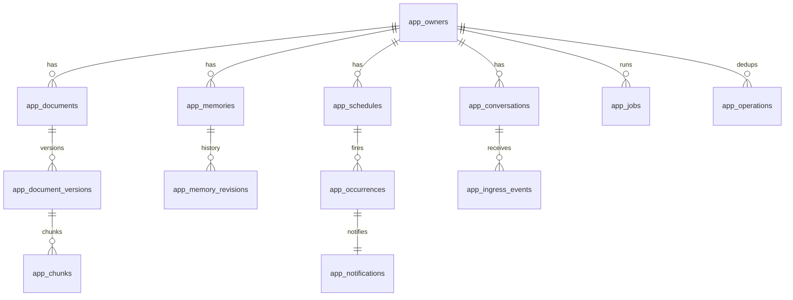

# 04 数据模型

- 版本：v1.0，2026-11-06
- 范围：只包括 `app_*` 业务表。`pi_*` 表由 pi-durable 负责，业务代码不得读写（ADR-01、ADR-02）。

## 1. 约定

- **ID**：除片段外，主键一律使用 UUIDv7 文本（`core/id.ts` 生成，可按时间排序）。片段用 `INTEGER PRIMARY KEY`，因为要作为 FTS 的 rowid。
- **时间**：`INTEGER`，UTC 毫秒时间戳，字段以 `_at` 结尾。展示用的时区单独存成 IANA 名称。
- **JSON**：`TEXT` 列，保存 canonical JSON（键排序），以 `_json` 结尾。
- **owner**：每张用户数据表都有 `owner_id NOT NULL`，所有索引都以 `owner_id` 开头。
- **状态**：用 `TEXT` 加 `CHECK` 约束限定取值。
- **迁移**：`packages/db/migrations/NNNN_name.sql`，只增不改；`app_schema_migrations` 记录已经执行过的迁移。
- **PRAGMA**：`journal_mode=WAL`、`foreign_keys=ON`、`busy_timeout=5000`。`synchronous` 保持 Pi 的设置（NORMAL）。

## 2. 实体关系



## 3. DDL（0001_init.sql）

```sql
-- 身份 ---------------------------------------------------------------
CREATE TABLE app_owners (
  id            TEXT PRIMARY KEY,
  display_name  TEXT NOT NULL,
  timezone      TEXT NOT NULL DEFAULT 'Asia/Shanghai',
  created_at    INTEGER NOT NULL
);

CREATE TABLE app_auth (
  owner_id        TEXT PRIMARY KEY REFERENCES app_owners(id),
  password_hash   TEXT NOT NULL,          -- scrypt$N$r$p$salt$hash（base64）
  failed_count    INTEGER NOT NULL DEFAULT 0,
  locked_until    INTEGER,
  updated_at      INTEGER NOT NULL
);

CREATE TABLE app_sessions (
  token_hash   TEXT PRIMARY KEY,          -- sha256(cookie 中的随机 token)，库里不存明文
  owner_id     TEXT NOT NULL REFERENCES app_owners(id),
  created_at   INTEGER NOT NULL,
  expires_at   INTEGER NOT NULL,
  last_seen_at INTEGER NOT NULL
);

-- 会话与入口 ---------------------------------------------------------
CREATE TABLE app_conversations (
  id                  TEXT PRIMARY KEY,
  owner_id            TEXT NOT NULL REFERENCES app_owners(id),
  pi_conversation_id  TEXT NOT NULL UNIQUE,
  kind                TEXT NOT NULL CHECK (kind IN ('chat','background')),
  title               TEXT NOT NULL DEFAULT '新对话',
  created_at          INTEGER NOT NULL,
  last_active_at      INTEGER NOT NULL,
  archived_at         INTEGER
);
CREATE INDEX app_conversations_owner ON app_conversations(owner_id, kind, last_active_at DESC);

CREATE TABLE app_ingress_events (
  id                 TEXT PRIMARY KEY,
  owner_id           TEXT NOT NULL,
  channel            TEXT NOT NULL CHECK (channel IN ('web','system')),
  client_request_id  TEXT NOT NULL,
  conversation_id    TEXT NOT NULL REFERENCES app_conversations(id),
  payload_hash       TEXT NOT NULL,       -- sha256(canonical {conversation, text, steer})：含会话 ID，同一个 client_request_id 发往不同会话也算冲突（R10）
  payload_json       TEXT,                -- {text, steer, tz}：只为崩溃恢复而存，派发成功后置 NULL，避免正文在业务库重复保存
  pi_request_id      TEXT NOT NULL,       -- "<channel>:<client_request_id>"
  submission_id      TEXT,                -- Pi submission ID，派发后写入
  status             TEXT NOT NULL CHECK (status IN ('accepted','dispatched','rejected')),
  reject_reason      TEXT,
  created_at         INTEGER NOT NULL,
  dispatched_at      INTEGER,
  UNIQUE (owner_id, channel, client_request_id)
);
CREATE INDEX app_ingress_pending ON app_ingress_events(status) WHERE status = 'accepted';

-- 工具幂等（ADR-04） --------------------------------------------------
CREATE TABLE app_operations (
  owner_id      TEXT NOT NULL,
  op_key        TEXT NOT NULL,            -- sha256(conv, run_anchor, tool, canonical args)；已含会话，故不另存 conversation_id（T-04 实现）
  tool          TEXT NOT NULL,
  args_json     TEXT NOT NULL,
  result_json   TEXT NOT NULL,            -- 原样返回给重放
  created_at    INTEGER NOT NULL,
  PRIMARY KEY (owner_id, op_key)
);
CREATE INDEX app_operations_owner ON app_operations(owner_id, created_at);

-- 知识库 -------------------------------------------------------------
CREATE TABLE app_documents (
  id            TEXT PRIMARY KEY,
  owner_id      TEXT NOT NULL,
  source_type   TEXT NOT NULL CHECK (source_type IN ('text','markdown','url')),
  source_uri    TEXT,                     -- url 类型为规范化后的 URL；其他类型为 NULL
  title         TEXT NOT NULL,
  status        TEXT NOT NULL CHECK (status IN ('pending','ready','failed','revoked','purging','purged')),
  current_version_id TEXT,
  tags_json     TEXT NOT NULL DEFAULT '[]',
  error_code    TEXT,
  created_at    INTEGER NOT NULL,
  updated_at    INTEGER NOT NULL,
  revoked_at    INTEGER
);
CREATE INDEX app_documents_owner ON app_documents(owner_id, status, updated_at DESC);
CREATE UNIQUE INDEX app_documents_url ON app_documents(owner_id, source_uri) WHERE source_uri IS NOT NULL;

CREATE TABLE app_document_versions (
  id              TEXT PRIMARY KEY,
  document_id     TEXT NOT NULL REFERENCES app_documents(id),
  owner_id        TEXT NOT NULL,
  content_hash    TEXT NOT NULL,          -- sha256(原始字节)
  raw_blob        TEXT NOT NULL,          -- 原始字节的 blob 哈希
  text_blob       TEXT,                   -- 抽取正文的 blob 哈希
  parser_version  TEXT NOT NULL,          -- 如 "readability@0.6+seg1"
  status          TEXT NOT NULL CHECK (status IN ('parsing','indexing','ready','failed','purged')),
  title           TEXT,
  summary         TEXT,                   -- P2：模型摘要
  summary_edited  INTEGER NOT NULL DEFAULT 0,
  char_count      INTEGER,
  captured_at     INTEGER NOT NULL,
  UNIQUE (document_id, content_hash)
);

CREATE TABLE app_chunks (
  id              INTEGER PRIMARY KEY,    -- = FTS rowid
  version_id      TEXT NOT NULL REFERENCES app_document_versions(id),
  document_id     TEXT NOT NULL,
  owner_id        TEXT NOT NULL,
  ordinal         INTEGER NOT NULL,
  heading_path    TEXT NOT NULL DEFAULT '', -- "一级标题 > 二级标题"
  char_start      INTEGER NOT NULL,       -- 在正文中的字符区间（UTF-16 code unit，与 JS 一致）
  char_end        INTEGER NOT NULL,
  text            TEXT NOT NULL,
  token_estimate  INTEGER NOT NULL,
  active          INTEGER NOT NULL DEFAULT 1, -- 文档撤销或删除时置 0
  UNIQUE (version_id, ordinal)
);
CREATE INDEX app_chunks_doc ON app_chunks(owner_id, document_id, active);

-- 分词后的文本（空格分隔），用 unicode61 建索引
CREATE VIRTUAL TABLE app_chunks_fts USING fts5(
  seg_text, heading_seg, tokenize = 'unicode61 remove_diacritics 2'
);
-- 原文子串，用 trigram 建索引
CREATE VIRTUAL TABLE app_chunks_tri USING fts5(text, tokenize = 'trigram');
-- 两张 FTS 表的 rowid 都等于 app_chunks.id；写入、删除由 knowledge 包在同一个事务中完成

-- 长期记忆（P2） -----------------------------------------------------
CREATE TABLE app_memories (
  id            TEXT PRIMARY KEY,
  owner_id      TEXT NOT NULL,
  kind          TEXT NOT NULL CHECK (kind IN ('preference','profile_fact','project_context')),
  key           TEXT NOT NULL,            -- 如 "review.verbosity"；同一作用域内唯一有效
  value         TEXT NOT NULL,            -- 自然语言，≤200 字
  scope         TEXT NOT NULL,            -- "global" | "project:<名称>"
  status        TEXT NOT NULL CHECK (status IN ('candidate','confirmed','superseded','revoked','rejected')),
  revision      INTEGER NOT NULL DEFAULT 1,
  source_json   TEXT NOT NULL,            -- {kind:"message"|"document", conversation_id?, entry_id?, version_id?, chunk_id?}
  supersedes_id TEXT,
  confirmed_at  INTEGER,
  created_at    INTEGER NOT NULL,
  updated_at    INTEGER NOT NULL
);
CREATE UNIQUE INDEX app_memories_active_key ON app_memories(owner_id, scope, key) WHERE status = 'confirmed';
CREATE INDEX app_memories_owner ON app_memories(owner_id, status, updated_at DESC);

CREATE TABLE app_memory_revisions (
  memory_id   TEXT NOT NULL REFERENCES app_memories(id),
  revision    INTEGER NOT NULL,
  value       TEXT NOT NULL,
  status      TEXT NOT NULL,
  changed_by  TEXT NOT NULL CHECK (changed_by IN ('user','tool','extractor')),
  changed_at  INTEGER NOT NULL,
  PRIMARY KEY (memory_id, revision)
);

-- 被拒绝或删除的记忆不会再被自动提取（FR-MEM-04）
CREATE TABLE app_memory_suppressions (
  owner_id    TEXT NOT NULL,
  fingerprint TEXT NOT NULL,              -- sha256(scope|key|规范化后的 value)
  reason      TEXT NOT NULL CHECK (reason IN ('rejected','deleted')),
  created_at  INTEGER NOT NULL,
  PRIMARY KEY (owner_id, fingerprint)
);

-- 记忆集合的版本号：用于 section 渲染的确定性（ADR-05）
-- 存在 app_settings 中，键为 'memory_set_revision:<owner>'

-- 提醒（P2） ---------------------------------------------------------
CREATE TABLE app_schedules (
  id              TEXT PRIMARY KEY,
  owner_id        TEXT NOT NULL,
  conversation_id TEXT REFERENCES app_conversations(id),
  text            TEXT NOT NULL,
  document_id     TEXT,                   -- 可选，关联的资料
  local_datetime  TEXT NOT NULL,          -- "2026-11-07T20:00"，用户看到的时间
  timezone        TEXT NOT NULL,          -- IANA
  next_fire_at    INTEGER,                -- UTC 毫秒；终态时为 NULL
  revision        INTEGER NOT NULL DEFAULT 1,
  status          TEXT NOT NULL CHECK (status IN ('active','fired','cancelled')),
  created_at      INTEGER NOT NULL,
  updated_at      INTEGER NOT NULL
);
CREATE INDEX app_schedules_due ON app_schedules(status, next_fire_at) WHERE status = 'active';

CREATE TABLE app_occurrences (
  id            TEXT PRIMARY KEY,
  schedule_id   TEXT NOT NULL REFERENCES app_schedules(id),
  revision      INTEGER NOT NULL,
  fire_at       INTEGER NOT NULL,         -- 计划触发时间
  fired_at      INTEGER NOT NULL,         -- 实际触发时间
  late_ms       INTEGER NOT NULL,         -- fired_at - fire_at
  UNIQUE (schedule_id, revision, fire_at)
);

CREATE TABLE app_notifications (
  id            TEXT PRIMARY KEY,
  owner_id      TEXT NOT NULL,
  dedupe_key    TEXT NOT NULL,            -- "occ:<occurrence_id>" 等
  kind          TEXT NOT NULL CHECK (kind IN ('reminder','job_failed','system')),
  title         TEXT NOT NULL,
  body          TEXT NOT NULL,
  link          TEXT,                     -- 站内路由
  created_at    INTEGER NOT NULL,
  read_at       INTEGER,
  UNIQUE (owner_id, dedupe_key)
);
CREATE INDEX app_notifications_unread ON app_notifications(owner_id, read_at, created_at DESC);

-- 后台作业 -----------------------------------------------------------
CREATE TABLE app_jobs (
  id              TEXT PRIMARY KEY,
  owner_id        TEXT NOT NULL,
  kind            TEXT NOT NULL CHECK (kind IN ('ingest_text','ingest_url','summarize','extract_memory','purge_document','backup')),
  dedupe_key      TEXT NOT NULL,          -- 如 "ingest_url:<url_hash>:<当日>"
  input_json      TEXT NOT NULL,
  checkpoint_json TEXT NOT NULL DEFAULT '{}', -- 已完成的阶段
  status          TEXT NOT NULL CHECK (status IN ('queued','running','succeeded','failed','cancelled')),
  attempts        INTEGER NOT NULL DEFAULT 0,
  max_attempts    INTEGER NOT NULL DEFAULT 3,
  next_attempt_at INTEGER NOT NULL,
  pi_conversation_id TEXT,                -- ADR-10：后台模型调用使用的专用会话
  error_code      TEXT,
  error_message   TEXT,                   -- 面向用户，不含堆栈
  created_at      INTEGER NOT NULL,
  updated_at      INTEGER NOT NULL,
  UNIQUE (owner_id, dedupe_key)
);
CREATE INDEX app_jobs_ready ON app_jobs(status, next_attempt_at) WHERE status = 'queued';

-- 外部投递（P3，MVP 只建表不使用） ------------------------------------
CREATE TABLE app_outbox (
  id              TEXT PRIMARY KEY,
  owner_id        TEXT NOT NULL,
  channel         TEXT NOT NULL,
  idempotency_key TEXT NOT NULL,
  payload_json    TEXT NOT NULL,
  status          TEXT NOT NULL CHECK (status IN ('pending','dispatching','succeeded','failed','unknown','needs_review')),
  attempts        INTEGER NOT NULL DEFAULT 0,
  external_ref    TEXT,
  created_at      INTEGER NOT NULL,
  updated_at      INTEGER NOT NULL,
  UNIQUE (channel, idempotency_key)
);

-- 运维 ---------------------------------------------------------------
CREATE TABLE app_events (
  id          TEXT PRIMARY KEY,
  level       TEXT NOT NULL CHECK (level IN ('info','warn','error')),
  kind        TEXT NOT NULL,              -- pi.task_faulted / job.failed / recovery.scan / backup.done …
  ref_json    TEXT NOT NULL DEFAULT '{}', -- 只放 ID
  message     TEXT NOT NULL,
  created_at  INTEGER NOT NULL
);
CREATE INDEX app_events_recent ON app_events(created_at DESC);

CREATE TABLE app_usage_monthly (
  owner_id    TEXT NOT NULL,
  month       TEXT NOT NULL,              -- "2026-11"
  model       TEXT NOT NULL,              -- "deepseek/deepseek-flash"
  input_tokens  INTEGER NOT NULL DEFAULT 0,
  output_tokens INTEGER NOT NULL DEFAULT 0,
  cache_read_tokens INTEGER NOT NULL DEFAULT 0,
  cost_usd    REAL NOT NULL DEFAULT 0,    -- 按目录价估算
  PRIMARY KEY (owner_id, month, model)
);

CREATE TABLE app_settings (
  key    TEXT PRIMARY KEY,
  value_json TEXT NOT NULL,
  updated_at INTEGER NOT NULL
);

CREATE TABLE app_schema_migrations (
  version    INTEGER PRIMARY KEY,
  name       TEXT NOT NULL,
  applied_at INTEGER NOT NULL
);
```

## 4. 状态机

### 4.1 资料与版本

```text
app_documents:  pending → ready | failed
                ready → revoked（停止使用，可以撤销回 ready）
                revoked|ready → purging → purged（彻底删除）
app_document_versions: parsing → indexing → ready | failed；purging 之后 → purged
```

- `revoked`：在同一个事务里把这份资料所有片段的 `active` 置为 0。检索和引用校验都会过滤 `active=0`。
- `purged`：原文和正文的 blob 被删除（前提是没有其他版本引用），`text` 清空，FTS 行被删除；只保留 `id`、`title` 和 `purged_at` 作为墓碑，用来告诉旧引用“已删除”。

### 4.2 记忆

```text
candidate → confirmed | rejected
confirmed → superseded（同一 key 有新值）| revoked（停用）
revoked → confirmed（重新启用，revision+1）
任何状态 → 物理删除（写入一条 suppression，再删除这一行和它的 revisions）
```

每次 `confirmed` 集合发生变化，`memory_set_revision:<owner>` 就加一（ADR-05）。

### 4.3 提醒

```text
active --到期--> fired
active --取消--> cancelled
active --修改--> active（revision+1，重新计算 next_fire_at）
```

### 4.4 作业

```text
queued → running → succeeded
                 → queued（失败且 attempts < max；next_attempt_at = now + 2^attempts × 30 s，加 ±20% 抖动）
                 → failed（attempts ≥ max，或错误不可重试）
queued|running → cancelled（用户取消；正在运行的阶段执行完后再停）
```

不可重试的错误码：`ssrf_blocked`、`too_large`、`unsupported_type`、`http_4xx`（408 和 429 除外）。

## 5. 不变式（测试中断言）

1. 每个 `confirmed` 记忆的 `(owner_id, scope, key)` 唯一（由部分唯一索引保证）。
2. 对于任意 `app_chunks.id = r`，当 `active=1` 时 `app_chunks_fts` 和 `app_chunks_tri` 中都存在 rowid 为 r 的行；`purged` 之后两张表中都不存在。实现上更强：**无论 `active` 是 0 还是 1，块与两张 FTS 表的行始终一一对应**（同一个事务里成对写入、成对删除；没有孤儿行）。`active` 只决定能不能被检索：半成品的版本、旧版本、被停止使用的资料的块都是 `active=0`，但 FTS 行都在。
3. `app_occurrences` 的 `(schedule_id, revision, fire_at)` 唯一，因此在线时一个提醒只通知一次。
4. `app_ingress_events.status='dispatched'` 时，`submission_id` 不能为 NULL。
5. 任何 `app_*` 查询都带有 `owner_id` 条件；仓储层的方法签名强制要求传入 `OwnerId` 类型的参数。

## 6. 导出格式（FR-OPS-01）

```text
export-<ts>.zip
  manifest.json            {version:1, exported_at, owner, counts}
  documents/<doc_id>/<version_id>/raw.<ext> 和 text.md、meta.json
  memories.json            confirmed 与 candidate，含 revisions
  reminders.json           schedules 与 occurrences
```

导出时排除：`app_auth`、`app_sessions`、`app_operations`、`app_events` 和 `pi_*`。对话记录作为单独的可选项，导出为 Markdown（P3）。
