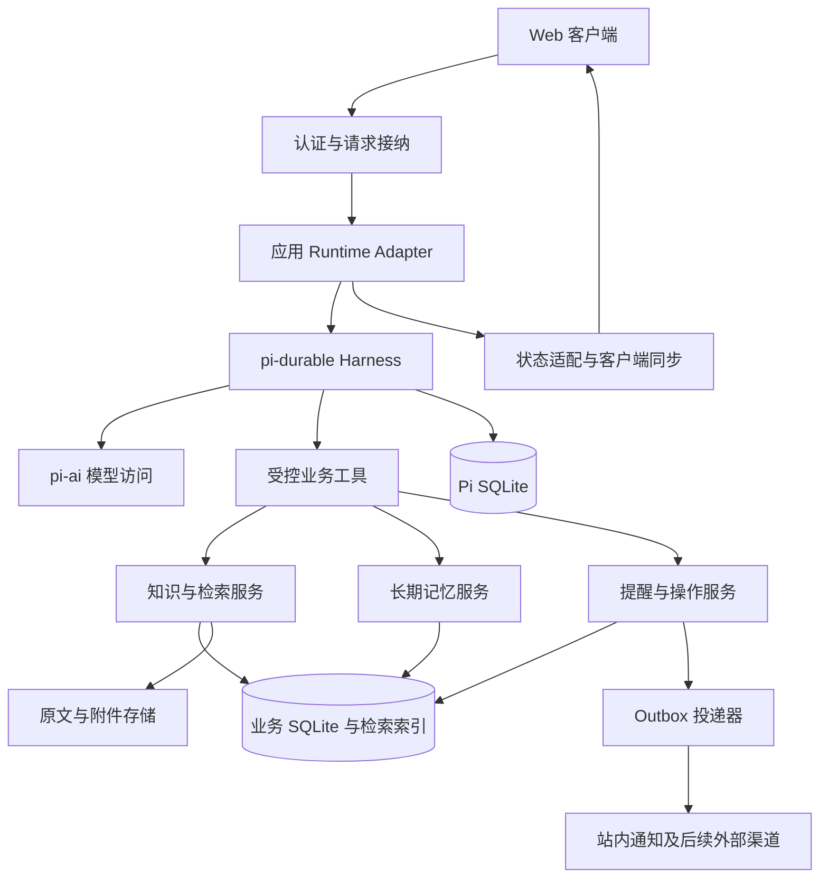
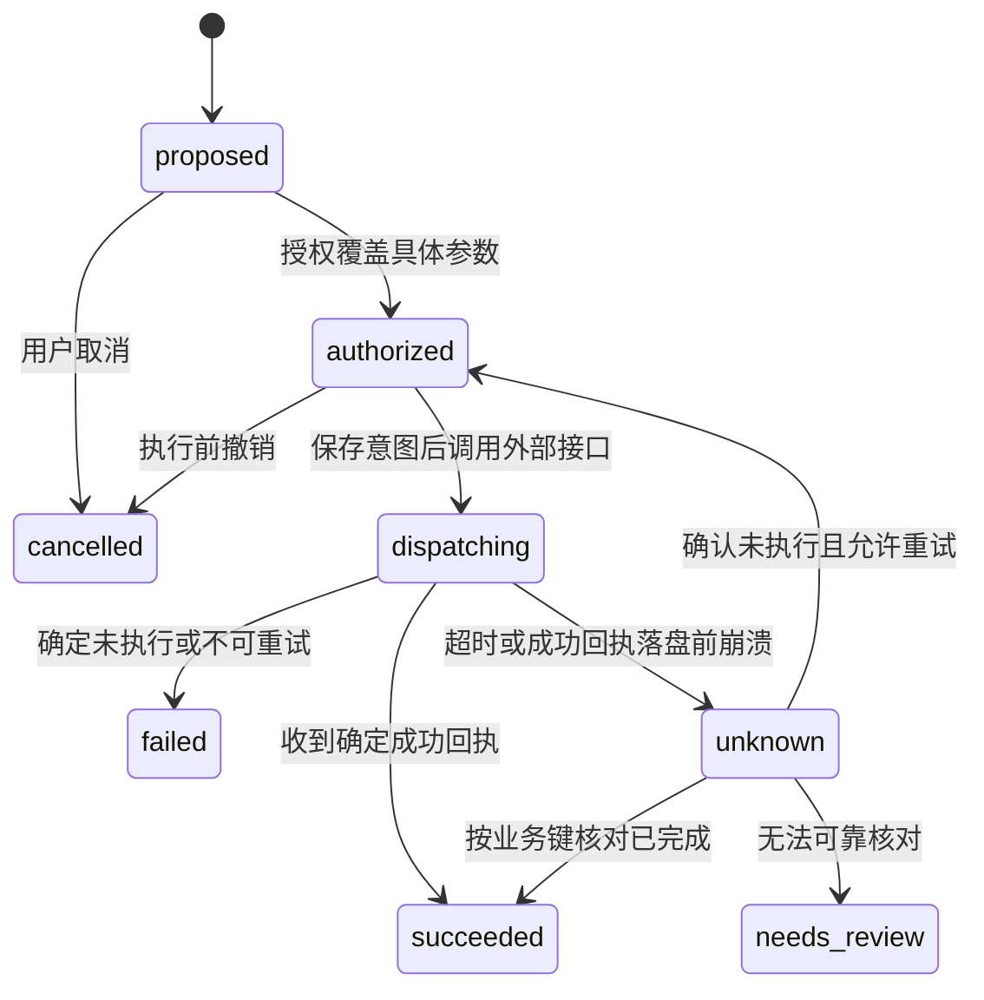

# 系统架构与执行一致性设计

## 架构决策

采用单进程模块化服务，将 pi-durable 包在 runtime adapter 内。知识库、记忆、提醒和外部操作使用应用自有领域模型。MVP 只运行一个会话拥有者进程；HTTP 服务与后台调度位于同一服务，不启动多个进程共同拥有同一 Pi storage。

以下模块、API、数据表和状态名称均为本项目设计，除显式标记的 Pi API 外，不代表上游已经提供这些功能。

## 模块职责

**入口层**验证身份、限制请求大小和速率、校验会话归属、分配稳定 event ID；只在输入成功持久化后回执已接纳。HTTP 连接断开不取消业务任务。

**Runtime Adapter**管理 Harness 生命周期、注册固定版本的 extensions、转换 submit 与状态接口，并把模型错误、存储失败、任务阻塞映射到产品状态。业务模块不导入 Pi 内部表结构。

**知识服务**负责文件与网页采集、内容版本、解析、分块、索引、检索和引用校验。大附件只以 URI、摘要和片段进入 transcript。

**记忆服务**处理用户偏好、项目背景、候选事实、冲突更新和撤销。以数据库中的当前有效状态为准，Pi Document 只保存必要工作状态和引用。

**提醒与操作服务**解析后校验时间、维护 schedule revision、创建业务操作意图、记录授权和投递结果。

**Outbox 投递器**按业务唯一键创建站内通知，或调用指定外部渠道。它对结果不明的请求执行查询与核对，而不是无条件重发。

## 存储分工

Pi 数据库保存 conversation、transcript、submission、任务检查点、Pi 自有状态及少量应用运行状态。使用官方 storage adapter；不手改内部表。

业务数据库保存以下实体：

- `documents` 和 `document_versions`：来源、内容哈希、解析版本和状态。
- `chunks` 与检索索引：片段、页码或段落定位、模型版本和删除版本。
- `memories`、`memory_evidence`、`memory_changes`：当前事实、来源和变更记录。
- `schedules`：用户、时间规则、时区、下一次到期、revision 与取消状态。
- `operations`：逻辑操作 ID、规范化参数哈希、授权、外部结果和核对状态。
- `outbox` 与 `notifications`：投递请求、唯一去重键、回执及已读状态。
- `ingress_events` 与 `jobs`：入口幂等记录和可恢复后台工作的业务状态。

附件存储保存原始字节和提取文本。索引允许重建，原文与用户确认记忆必须备份。每条数据都带 owner_id，即使 MVP 只有一个用户，也不能靠全局默认用户绕过访问检查。

## 两份数据库之间的一致性

不假设 Pi SQLite 和业务 SQLite 共享事务。采用业务幂等记录与可重试派发，并提供恢复扫描。

入口请求先在业务库事务内写 `ingress_events`，唯一键为 `(owner_id, channel, external_event_id)`，同时固化 conversation_id、payload_hash 与 Pi requestId。派发器调用 Pi `submit()`；成功后标记 dispatched。若在 submit 成功后、标记前崩溃，恢复时仍向同一 conversation 提交同一个 requestId。哈希不一致的同 ID 请求拒绝，不能静默返回旧请求。

业务工具写知识、记忆或提醒时，在业务事务中执行 `operation_id` 唯一检查、数据变更和结果记录。若工具写入后 Pi 结果还未保存就崩溃，重跑会读取相同业务结果。索引任务通过业务 outbox 生成，使用 `(document_version, parser_version, index_version)` 去重。

框架内部状态需要与输入一起提交时，可以使用 1.5.0 的 `submit(tx, draft)`，但遵守调用顺序约束；这只能保证同一 Pi commit 内的原子性，不能扩展到业务库或远程 API。[发布包 README 的 Busy Conversations](sources/published-1.5.0/package/README.md)

## 逻辑操作 ID 与工具重放

同一次用户请求中的逻辑动作应拥有稳定 operation_id，跨崩溃、模型重新调用和人工核对保持不变。仅使用工具 task ID 不够：模型在收到 interrupted 后可能创建一个全新的工具调用。按业务语义建立唯一约束，例如提醒 ID 与 revision、文档版本哈希、用户请求中的明确动作项 ID。

建议的工具分类：

- `kb.search`、`kb.get_source`、`memory.list`：只读；可声明 replay safe，但重放时仍重新检查权限。
- `kb.capture`、`memory.upsert_explicit`、`reminder.create`：有写入；先完成业务幂等机制，才可声明 replay safe。
- `notification.dispatch_external`：只在渠道支持稳定幂等键或可查询结果、且实现完成时自动重试；否则使用不可自动重放路径，并处理不确定结果。
- 删除、共享、外发等操作：需要具体操作授权和执行时再校验；首次启动 MVP 不暴露给模型。

`replay: "unsafe"` 不能保证不会重复发送，只能控制同一个中断工具任务的恢复。业务层仍须阻止新调用绕开去重。[官方 Tools 与规范 Effect sandwich](https://github.com/earendil-works/pi/blob/2a32a605a9f18a5f0191f65358a2e764b2f69fc7/packages/durable/docs/spec.md)

## 外部效果状态机

这是应用状态，不是 Pi 原生状态。授权绑定 operation_id、目标、参数哈希、权限范围和有效期；重启或重试必须检查当前权限，参数变化需要新的授权。投递开始后的取消可能来不及阻止效果，返回“正在核对”比谎报“已取消”更准确。

Outbox 保证投递意图可恢复；它本身不消除“远端成功、本地未记账”的窗口。对于站内通知，可用数据库唯一键保证逻辑记录只创建一次。对无幂等契约的外部渠道，只能明确选择可能重复的至少一次投递，或结果不明时停下来核对；本方案默认后者。

## 一次性与周期提醒

1. 将自然语言转为完整日期时间、IANA 时区和 UTC instant，向用户显示解析结果。示例默认时区 Asia/Shanghai；未来跨时区时，不使用固定偏移替代时区规则。
2. 在业务库创建 schedule 与待派发记录，分配 revision。
3. 幂等建立 Pi durable task。等待阶段使用 `runtime.sleepUntil()`，到期进入独立 delivery 阶段。
4. delivery 重新读取 schedule，验证未取消、revision 未过期、权限仍有效，然后创建唯一 occurrence 与 outbox。
5. 投递器处理站内通知；任务完成状态反映业务实际状态，不能用模型一句“提醒已发”作为凭据。

周期任务留到 P2：以用户本地日历规则计算下次时间，避免简单加 24 小时。每次出现使用 `(schedule_id, revision, occurrence_instant)` 唯一键。修改 schedule 使旧 revision 失效；恢复扫描补建遗漏的任务或到期 occurrence。

离线策略建议：短时一次性提醒恢复后补发并标记迟到；周期简报只补最近一期，避免重启后集中推送所有遗漏期。用户可配置策略。主机关机时 durable timer 无法发消息。[官方休眠机制](sources/published-1.5.0/package/README.md)

## 应用 API 草案

以下是建议的 HTTP 接口，不是 pi-durable 自带服务：

- `POST /v1/conversations/:id/messages`：接收 client_request_id 与 content，返回 submission_id、job_id 和 accepted；等待完成由独立查询处理。
- `GET /v1/conversations/:id/state`：返回会话快照、revision、已提交条目和活动任务。
- `GET /v1/conversations/:id/stream`：用 SSE 或 WebSocket 传状态更新；重连先取快照，不能只重放客户端自行拼装的 token。
- `POST /v1/jobs/:id/cancel`：取消运行或排队工作，并返回当前可确认状态。
- `POST /v1/sources`、`GET /v1/sources/:id`：采集与查询资料版本。
- `GET /v1/memories`、`PATCH /v1/memories/:id`、`DELETE /v1/memories/:id`：查看、修改、遗忘。
- `POST /v1/reminders`、`PATCH /v1/reminders/:id`：创建、调整或取消提醒。
- `POST /v1/operations/:id/decision`：仅对需要具体操作授权的请求使用，保存参数版本与用户决定。

所有资源查询都校验 owner_id。模型参数中传入的 owner_id 或权限标记不可信，工具执行时从服务端会话身份注入。

## 安全与部署

MVP 不安装 CodingTools 整套文件和 shell 能力。网页采集器限制 http/https、响应大小、时间、重定向次数，并阻止 loopback、内网、链路本地和云元数据地址；DNS 与重定向都重新校验，防止 SSRF。附件解析放入独立受限进程，设大小、页数和超时限制。

模型凭据只在服务端，网页和记忆不存凭据。连接器令牌与语料分开，按最低权限授予。公开 Web 服务使用 TLS 与认证；本地服务默认只绑定 loopback。日志优先记录 ID 和状态，异常信息也需要脱敏。

单实例用服务管理器自动重启，并加应用级独占启动保护。滚动发布不能让新旧进程同时拥有同一 storage。升级顺序是停止接纳、尽量排空、关闭、备份、升级、恢复、核对；持久化任务定义变化要有迁移或保留旧实现。[官方所有权与恢复约束](sources/published-1.5.0/package/README.md)

## 备份与删除边界

初期采用短暂停写、关闭服务后的一致性备份，涵盖 Pi 库、业务库、附件和配置版本清单。不能只复制正在写入的 SQLite 主文件而忽略 WAL。恢复时暂停外部投递，先核对备份之后可能已完成的效果，避免恢复旧库后重复通知。

索引删除不等于彻底遗忘。被模型引用的资料可能已进入 transcript、压缩摘要、日志和备份；删除设计详见[知识与记忆文档](04-knowledge-and-memory.md)。没有完成这些处理前，界面不能声称“已彻底删除”。
